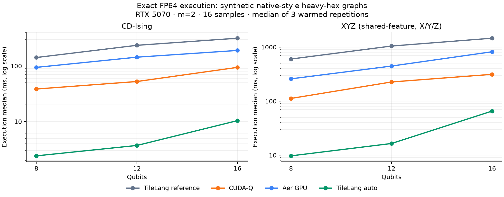

# Phase 3: TileLang on native-style sparse graphs

Batching and exact gate fusion accelerated both CD-Ising and XYZ in these measured cases. The improvement depends strongly on sample count and depth; these are execution-path results, not a universal TileLang/compiler speedup.



## Protocol

- NVIDIA GeForce RTX 5070; FP64; exact expectations; CUDA 13.0; TileLang 0.1.15, PyTorch 2.14.0, CUDA-Q 0.16.0.post1, Aer GPU 0.15.1.
- Synthetic heavy-hex connectivity generated by Qiskit, with an induced connected physical subgraph selected by the library. These are not live IBM device calibrations. A saved real graph can be supplied to the same runner.
- Main grid: 8/12/16 qubits, m=1/2, 64 fitting rows, 16 evaluation rows, one fitted block. XYZ uses shared-feature encoding with X/Y/Z, diagonal/cross interactions and cross observables. CD-Ising uses native-edge Z/ZZ readout.
- Every engine uses the same prepared circuit, theta matrix and observables in a case. All results are checked against the reference implementation; up to two rows are also checked independently with Qiskit CPU.
- The reference is the retained phase-2 per-sample/per-observable implementation. Full and auto use fused batched matrices; auto selects full states or causal cones by estimated work.
- Reported execution medians exclude fit, parameter preprocessing and warm-up. Parameter-plus-execution medians and common fit time are separately included in JSON/CSV. Synchronized profiling is a separate untimed run.
- `cold_execution_seconds` is the first call to an engine within a shared process, not an independently cold process: compiler caches can be primed by earlier engines. Do not compare that field as standalone cold-start performance.
- `torch_peak_allocated_bytes` describes Torch allocations for TileLang, not whole-device peak usage or CUDA-Q/Aer memory.
- Raw reports include all repetitions, data/parameter/topology hashes, backend-specific statistics, package versions and source hashes. Sources were uncommitted; the source hashes identify the implementation actually run.

## Main grid

Each value is a warmed execution median of three repetitions, for 16 samples.

| Map | Qubits | m | Observables | TileLang auto (ms) | CUDA-Q (ms) | vs CUDA-Q | vs reference | Path |
|---|---:|---:|---:|---:|---:|---:|---:|---|
| cd-ising | 8 | 1 | 15 | 1.906 | 29.287 | 15.36× | 43.99× | batched_full |
| xyz | 8 | 1 | 87 | 5.406 | 78.142 | 14.45× | 68.52× | batched_full |
| cd-ising | 8 | 2 | 15 | 2.417 | 38.430 | 15.90× | 58.58× | batched_full |
| xyz | 8 | 2 | 87 | 9.707 | 112.199 | 11.56× | 61.94× | batched_full |
| cd-ising | 12 | 1 | 24 | 2.141 | 39.946 | 18.66× | 65.75× | batched_full |
| xyz | 12 | 1 | 144 | 9.568 | 170.589 | 17.83× | 63.91× | batched_full |
| cd-ising | 12 | 2 | 24 | 3.716 | 52.423 | 14.11× | 63.14× | batched_full |
| xyz | 12 | 2 | 144 | 16.437 | 226.208 | 13.76× | 63.64× | batched_full |
| cd-ising | 16 | 1 | 32 | 5.116 | 50.077 | 9.79× | 36.89× | batched_cones |
| xyz | 16 | 1 | 192 | 39.720 | 222.879 | 5.61× | 20.91× | batched_full |
| cd-ising | 16 | 2 | 32 | 10.386 | 94.190 | 9.07× | 30.31× | batched_full |
| xyz | 16 | 2 | 192 | 65.537 | 313.115 | 4.78× | 22.28× | batched_full |

## Additional configurations

These use 8 qubits and m=1. Single-row medians use five repetitions; the others use three. Each configuration has its own identical-across-engines inputs. Different row-count configurations are not claimed to share the same input prefix.

| Configuration | Map | Samples | Features | Fitted blocks | Auto (ms) | vs CUDA-Q | vs reference |
|---|---|---:|---:|---:|---:|---:|---:|
| Single row | cd-ising | 1 | 8 | 1 | 1.515 | 1.51× | 4.32× |
| Single row | xyz | 1 | 8 | 1 | 4.788 | 1.16× | 5.10× |
| 128-row batch | cd-ising | 128 | 8 | 1 | 2.944 | 91.08× | 237.66× |
| 128-row batch | xyz | 128 | 8 | 1 | 11.194 | 67.64× | 288.57× |
| Two shared-feature blocks | cd-ising | 16 | 16 | 2 | 3.837 | 11.18× | 36.74× |
| Two shared-feature blocks | xyz | 16 | 16 | 2 | 10.488 | 11.83× | 61.90× |
| XYZ multi-axis X/Y/Z | xyz | 16 | 24 | 1 | 5.711 | 15.69× | 69.95× |

## Interpretation and limits

- All 95 measured engine/configuration combinations passed numerical comparisons. Maximum error against the independently checked CPU rows: 1.5e-14.
- At 16 qubits, m=1, CD-Ising selected 2 cones with maximum width 15. Auto took 5.116 ms versus 6.911 ms for fused full states; Torch peak allocation was 16.96 MiB versus 34.09 MiB.
- Other main-grid cases selected full states. Their improvements primarily reflect batching, fusion, matrix sharing and grouped GPU reductions. Sparse topology alone does not guarantee small cones: gate order, depth and measured support matter.
- The single-row measurements show much smaller gains than the larger batches. The measured ranges must not be applied to a different batch size or Hamiltonian configuration.
- CPU matrix preparation and data-to-angle preprocessing remain relevant. Fit/feature-assignment time is not accelerated; repeated fitting or small datasets can substantially reduce the benefit for a complete ML pipeline.
- No MPS approximation, noise, QPU submission or feature-map/readout change was used. The original GPU environment received no package changes in this phase.

## Reproduce

These measurements use the phase-3 FP64 exact implementation. Its four hashed
source files are preserved in [tilelang_phase3_source.tar.gz](tilelang_phase3_source.tar.gz);
all five JSON reports' `source_sha256` entries match that archive. Later FP32
and sampling changes are not part of these historical measurements.

Run these one at a time, separately from other GPU work:

```bash
.venv_tilelang/bin/python scripts/benchmark_tilelang.py --qubits 8 12 16 --steps 1 2 --rows 16 --repeats 3 --output /tmp/tilelang-main.json
.venv_tilelang/bin/python scripts/benchmark_tilelang.py --qubits 8 --steps 1 --rows 1 --repeats 5 --output /tmp/tilelang-single.json
.venv_tilelang/bin/python scripts/benchmark_tilelang.py --qubits 8 --steps 1 --rows 128 --repeats 3 --output /tmp/tilelang-batch128.json
.venv_tilelang/bin/python scripts/benchmark_tilelang.py --qubits 8 --steps 1 --rows 16 --blocks 2 --repeats 3 --output /tmp/tilelang-blocks2.json
.venv_tilelang/bin/python scripts/benchmark_tilelang.py --qubits 8 --steps 1 --rows 16 --blocks 3 --maps xyz --encoding multi_axis --repeats 3 --output /tmp/tilelang-multiaxis.json
```

[Main raw JSON](tilelang_phase3.json), [CSV](tilelang_phase3.csv), [single row](tilelang_phase3_single_row.json), [batch of 128](tilelang_phase3_batch128.json), [two blocks](tilelang_phase3_blocks2.json), [multi-axis](tilelang_phase3_multiaxis.json), [vector plot](tilelang_phase3.svg).
